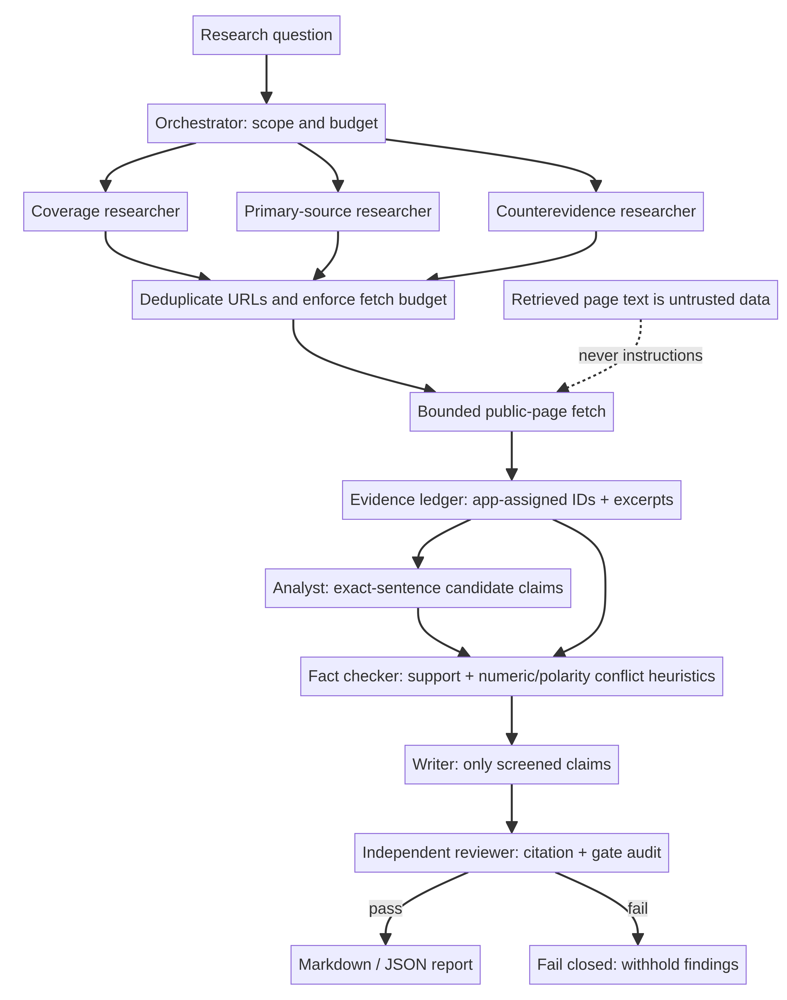

# Multi-Agent Research System

Project 08 in the AI/ML portfolio: a local-first research workflow with independently scoped research workers, an evidence ledger, claim-level screening, a cited writer, and a fail-closed reviewer. It extends the bounded research foundation in Project 07 with explicit role boundaries and quality gates. It needs no API key, model download, or paid service.

## Why use multiple agents here?

The roles perform different work and exchange typed artifacts rather than sharing one unconstrained prompt. Three concurrent researchers pursue broad coverage, primary/official sources, and counterevidence. The analyst selects candidate sentences but cannot certify them. A separate fact checker compares each candidate against all retrieved excerpts and flags possible numeric or polarity conflicts. The writer is only allowed to use screened candidates, and the reviewer independently checks citation IDs, verbatim provenance, and gate status before the orchestrator releases a report.

That separation is useful when source pages disagree, a candidate adds an unsupported detail, or an output loses its citation: there is a specific stage that can flag or block the issue, and the agent trace shows where. A monolithic one-pass answer has no independent stage to challenge its own claims. The trade-off is more orchestration, added search latency, and conservative false rejections. The built-in ablation measures the value of a screening gate on synthetic adversarial cases; it is not a benchmark of real-world research accuracy.

These “agents” are distinct, deterministic software components with separate contracts and a coordinator. No LLM is required or called; that keeps the demo reproducible and avoids implying that multiple model calls alone create quality. The roles can later be backed by separately permissioned models, but model-generated answers would still need the same evidence and review gates.

## Architecture



1. **Coordinator** creates three bounded research mandates and runs their searches concurrently.
2. **Coverage researcher** searches the question directly; **primary-source researcher** seeks official or original material; **counterevidence researcher** seeks limitations or contrary material. The coordinator deduplicates URLs and caps page fetches.
3. **Researcher coordinator** fetches public static HTML, stores short excerpts and retrieval metadata, and assigns source IDs in application code.
4. **Analyst** selects relevant sentences verbatim and records candidate claim/source links.
5. **Fact checker** treats only exact normalized text in an excerpt as citation support; token overlap and simple numeric/polarity heuristics are used to flag possible conflicts, not to add citations. It labels claims `single_source`, `multi_source_match`, `disputed`, or `unverified`.
6. **Writer** includes only `single_source` and `multi_source_match` findings and retains their evidence IDs.
7. **Reviewer** checks that every released finding passed the gate and exactly appears in its cited excerpt. The orchestrator withholds all findings if this structural audit fails.

## Run it

Requires Python 3.10 or newer. The core package uses only the Python standard library.

```bash
cd multi-agent-research-system
python -m pip install -e '.[test]'

# Offline end-to-end example; makes no network requests
research-team --demo
# Or use the module form
python -m multi_agent_research --demo --json
# Bounded live web research (DuckDuckGo Lite is best-effort and may change)
research-team "What evidence supports ...?" --max-results 5 --max-pages 5

# Tests and synthetic ablation
python -m pytest
python evaluation/ablation.py
```

The worker count is fixed at three. The implementation hard-caps search results to 8 per intent, unique pages to 6, excerpt size to 2,200 characters, result HTML to 700 KB, page HTML to 1 MB, and each network request to a 12-second total caller deadline. A timed-out synchronous socket operation may continue in a daemon worker until it completes or its socket timeout fires; a global cap of nine workers prevents unbounded accumulation. CLI limits cannot raise these hard bounds. Search and page-fetch failures become visible warnings; a run with no usable evidence returns no findings rather than filling the gap.

## Evaluation: demonstrate the extra gate

`evaluation/ablation.py` sends six original synthetic candidate claims through the same fact-check screen and contrasts the result with a direct-publish baseline that accepts every candidate. The cases include a supported claim, a repeated multi-URL text match, an invented quantity, a conflicting year, a negation conflict, and an unrelated unsupported claim. The script writes its exact output to `evaluation/ablation_results.json`.

The evaluation answers a narrow engineering question: does this gate block the known unsupported or conflicting candidates in these fixtures? It does not evaluate search recall, entailment, source credibility, real-world fact-checking, or the quality of the Analyst's selection. Synthetic content is not an external benchmark and must not be presented as one.

## Safety and limitations

- Only HTTP(S) pages with publicly resolving destinations are fetched. Private/loopback IP addresses and local hostnames are rejected; redirects are checked again. DNS checks are best-effort, not a substitute for network-level egress controls.
- The system fetches static HTML only. It does not execute scripts, follow page instructions, use page text to select tools, load PDFs, authenticate, or publish data. Retrieved text is untrusted data.
- Search uses DuckDuckGo Lite HTML, an unstable interface that may be blocked or change. Respect search and destination-site terms and access controls.
- Source IDs and exact normalized excerpt checks establish provenance, not truth, authority, recency, or entailment. Token overlap is not citation support or semantic verification. Numeric/polarity conflict flags are heuristic and can miss contradictions or flag unrelated facts.
- Multiple URLs can mirror one press release or syndicate identical text. `multi_source_match` means only that the same exact normalized claim text appeared at multiple URLs; the project does not infer source independence.
- Relevance is lexical, so paraphrase, multilingual text, dialects, complex claims, and topics with little word overlap may be missed. Single-source claims remain weakly supported and are labeled as such.
- A live smoke on 2026-11-02 received DuckDuckGo HTTP 202 anti-bot challenge markup, so end-to-end live search/fetch is not verified. The adapter reports detected provider challenges as explicit failures; see [the smoke note](evaluation/live-smoke.md).
- There is no model training, live quality benchmark, hosted demo, HF artifact, or GitHub release in this local build.

## Project status

The local implementation, synthetic demo, and offline test suite are in this repository. Public GitHub release remains pending the approved `bereket-web` owner having the correct access; this project has no remote and has not been published under `bereket74`. No Hugging Face token was used or reused.
